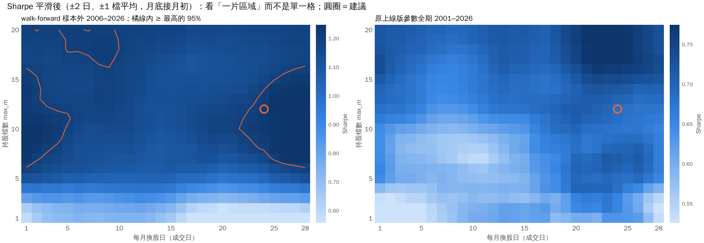
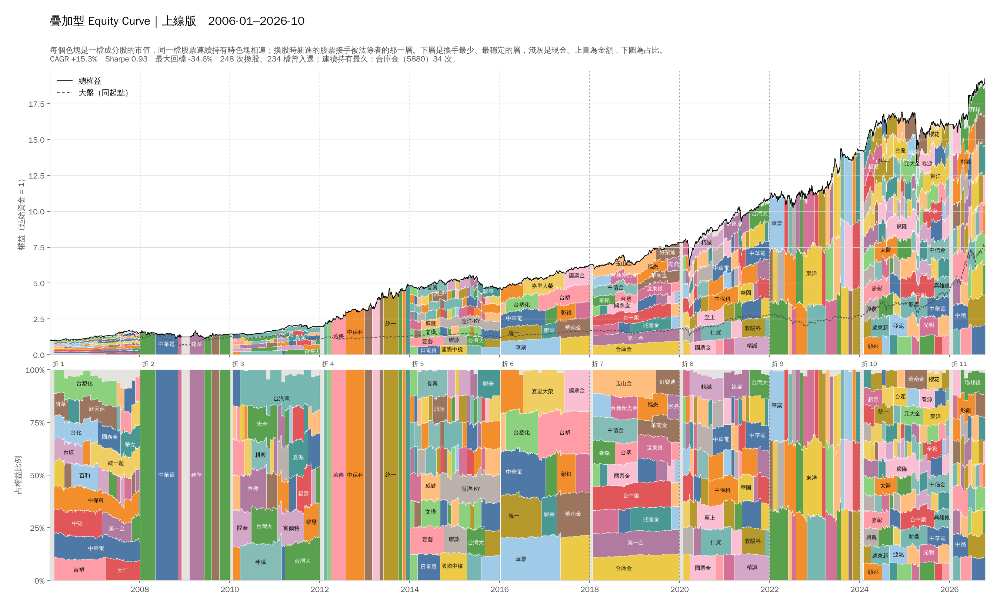

# 長期穩定上漲股投資組合策略 (Taiwan)

從台股歷史股價中挖掘「長期穩定上漲」的波段，據以設計一套**穩定上漲分數**與投資組合策略，
並以 Walk-Forward Cross Validation 優化超參數、產出上線版策略。

> **AI model declaration** — 本專案的設計與程式碼由 **Claude Opus 5.5** (Anthropic) 透過 Claude Code 完成。

---

## 核心概念

對一段股價取對數後做線性回歸 `log(price_t) = a + b·t + e_t`，得到兩個數字：

| 名稱 | 定義 | 單位 |
|---|---|---|
| `slope` | `exp(b × 252)` | **年化成長倍數**。`1.05` = 每年漲 5% |
| `stdev` | `exp(sd(e))` | **乘法型殘差離散度**。`1.2` = 股價大致落在趨勢線 ±20% |

兩者都是「倍數」而非對數值，所以門檻讀起來很直覺。

**關鍵設計：分數對斜率不是單調遞增的。** SPEC 指出三種要避開的狀況，分數用四個相乘的項各自對付一種：

```
score = trend × stability × consistency × restraint
```

| 項 | 作用 | 對付的問題 |
|---|---|---|
| `trend` | 以 `g_opt` 為峰的**倒 U 型**（對數成長空間的高斯） | 斜率太大無法持久 ＋ 斜率近乎零的「不動股」 |
| `stability` | 隨殘差離散度遞減 | 「穩定」本身 |
| `consistency` | 回顧期切成 `n_sub` 段，**每段都要各自上漲** | 一次暴衝、其餘時間不動 → performance chasing |
| `restraint` | penalise 現價高出自身趨勢線太多（以殘差 σ 計） | 買在剛噴出的位置 → performance chasing 的時機面 |

每一項都在 `(0, 1]`，所以任何一項都可以單獨否決一支股票。倒 U 型的寬度 `g_width` 必須夠窄才有鑑別力：
在 `g_opt = 1.30` 下，寬度 1.15 會讓「零成長」只拿到約 0.17 分、「年化 +400%」趨近 0 分。

---

## 安裝

需要 Python 3.13+。

```bash
python -m pip install -e .
```

Windows 主控台請先設定 UTF-8（否則中文股名會亂碼）：

```bat
set PYTHONUTF8=1
chcp 65001
```

## 使用流程

```bash
# 1. 下載台股歷史股價 (上市 + 上櫃普通股 ≈ 1970 檔，2000 年起) 與大盤 ^TWII
python -m twstable fetch

# 2. 挖掘上漲波段：反向超參數優化，指定要 n 段波段、m 支股票
python -m twstable mine -n 1000 -m 150

# 3. 觀察上漲波段 (K 線 + 迴歸線)
python -m twstable view-segments

# 4. 回測投資組合策略
python -m twstable backtest

# 5. 觀察回測過程 (equity curve / MDD / 每次換股的持股)
python -m twstable view-backtest

# 6. Walk-Forward CV 超參數優化（第一次，各折自選換股間隔與檔數）
python -m twstable wfcv --train-years 6 --test-years 2 --trials 400
python -m twstable view-backtest --result results/wfcv.json

# 6'. 上線版：固定每月 24 日、12 檔、權重上限，其餘參數重新搜尋（見第五節）
python -m twstable wfcv --train-years 6 --test-years 2 --trials 400 \
    --fix '{"rebalance_day": 24, "holiday": "next", "max_m": 12, "cap_weight": true, "weighting": "equal"}' \
    --out results/wfcv_monthly.json
python -m twstable view-backtest --result results/wfcv_monthly.json

# 也可以把任一組參數餵回回測
python -m twstable backtest --params results/production_params.json

# 7. 產生可分享的單檔 HTML 報告 → docs/index.html
python -m twstable report

# 8. 換股日 × 假日規則 × 持股檔數（9,122 組，4 核心約 15 分鐘）→ results/hyper/
python -m twstable sweep
python -m twstable sweep-report   # 只從 grid.csv 重做圖與 SUMMARY.md（幾秒，不跑回測）

# 9. 持股變化：逐次換股重播 7 個實驗（約 20 秒）→ results/explore/
python -m twstable explore
python -m twstable stacked        # 疊加型 equity curve → results/explore/<實驗>/stacked.png（約 50 秒）
python -m twstable viewer         # 網頁 viewer 與資料 → docs/viewer/（約 1 分鐘）
```

`results/` 產出的檔案：

| 檔案 | 內容 |
|---|---|
| `segments.csv` | 上漲波段（波段 viewer 的輸入） |
| `segment_pool.npz` | 候選波段池快取；設定改變時會自動重新挖掘 |
| `backtest.json` | 預設參數的回測結果（回測 viewer 的輸入） |
| `wfcv.json` | 第一次 WFCV：**串接後的 OOS 曲線 + 各折參數與指標**，同樣可餵給回測 viewer；換股日實驗以它為基礎 |
| `wfcv_monthly.json` | **上線版** WFCV：固定每月 24 日、12 檔、權重上限後重新搜尋（第五節） |
| `production_params.json` | 上線版超參數（＝ `wfcv_monthly.json` 的 `production_params`） |
| `hyper/` | 換股日 × 持股檔數實驗：`grid.csv`（每組指標）、`curves.parquet`（每組月底權益）、`SUMMARY.md`（結論與圖）、`recommended_params.json` |
| `explore/<實驗>/` | 逐次換股重播（第六節）：`trace.json`（每次換股的持股與權重、各折參數、指標）、`scores.parquet`（曾上榜股票每次的分數與排名）、`curve.parquet`、`positions.parquet`（每檔每日市值），以及 `stacked.png` |

## 可分享的網頁報告

`python -m twstable report` 會把上線版的 `results/wfcv_monthly.json` 轉成 **`docs/index.html`**：
一個完全自足的單檔網頁（無 CDN、無外部請求、無建置步驟），內含互動式
equity curve 與回檔對照圖、二十年總指標表、各折 OOS 成績，以及深/淺色主題切換。

直接用瀏覽器開啟即可，或本機起一個 server：

```bash
python -m http.server -d docs
```

推上 GitHub 後，到 **Settings → Pages → Source 選 `main` 分支的 `/docs` 資料夾**，
就會有一個公開網址可以分享（目前已開：<https://caridina-ai.github.io/tw-stock-stable-yfinance/>）。
報告頂端連到 `docs/viewer/` 的持股變化 viewer（第六節），它由 `python -m twstable viewer` 產生。

> 頁面的數字是**產生當下寫死**的。重跑回測之後記得重新執行 `python -m twstable report`，
> 否則網頁會停留在舊結果。

需要嵌進別人的頁面時加 `--fragment`，會只輸出 body 內容（不含 `<head>` 與主題切換鈕）。

---

## 一、挖掘長期穩定上漲波段

### 正向問題

給定 `(min_length, max_stdev, min_slope)`，篩出 `n` 段波段、涵蓋 `m` 支股票。

### 反向問題（SPEC 要求）

**給定 `n` 與 `m`，反推最佳的 `(min_length, max_stdev, min_slope)`。**

作法分兩階段：

1. **候選池** (`build_pool`)：對每支股票掃描「長度 × 起點」網格。長度採等比數列（40 → 1500 交易日，
   比例 1.15），起點步長隨長度縮放。每個視窗的回歸用**前綴和**在 O(1) 時間算出，因此可以窮舉
   全市場約 4,600 萬個視窗。接著在各長度分帶內以時間重疊率 (IoU) 做非極大值抑制，
   把高度重複的視窗收斂成各時間尺度的代表性波段。

2. **精確網格求解** (`solve_nm`)：目標函數
   `loss = w_m·|m−m*|/m* + w_n·|n−n*|/n*`（`w_m = 2` 因為 SPEC 把股票數寫成硬性條件、波段數寫成「最接近」）。

   這不是爬山法——是**窮舉**。固定 `min_length` 後，波段數在 `(max_stdev, min_slope)` 的二維門檻網格上
   就是一個二維累積直方圖；而「相異股票數」則由每支股票在各 slope 門檻下的**最小 stdev 的後綴最小值**
   得出。兩者都是 O(pool + bins²)。再讓 `min_length` 由大到小遞減走訪，子集合具有巢狀性質，
   整個搜尋只需掃過候選池一次。因此答案與起始猜測無關，且 `tests/test_mining.py`
   直接對照暴力枚舉驗證其最優性。

### Demo 結果 (n = 1000, m = 150)

```
min_length=655   max_stdev=1.0345   min_slope=1.0249
  -> n=1003 (target 1000), m=152 (target 150)
```

`min_length = 655` 交易日（約 2.6 年）符合「長期」，`max_stdev = 1.0345` 代表股價
幾乎貼著趨勢線走（±3.5%），`min_slope = 1.0249` 要求每年至少漲約 2.5%。輸出於 `results/segments.csv`。

（候選池會記錄自己是用哪組設定挖的；資料範圍或參數一變，`mine` 會自動重挖，
不會拿舊快取給你錯的答案。）

### 波段 Viewer

`python -m twstable view-segments`

紅漲綠跌的 K 線、藍色回歸線、±1σ 帶狀區。**按 `L` 切換 Y 軸 linear / log**：
log 模式下迴歸線是直線，linear 模式下同一條線呈指數曲線。

> 別期待 linear 模式會看到明顯的上彎：曲率取決於波段的**總漲幅**，而挖出來的波段
> 中位數漲 25.2%、最大 +149.8%；即使是最大的那一段，曲線與其弦的最大落差也
> 只有畫面高度的約 11%，多數波段遠低於此。真正一眼可辨的差別是 **±1σ 帶**——它是乘法帶，log 下等寬，
> linear 下會隨股價往右張開。要判斷成長速度請看標題的 `slope`，不要用眼睛量曲率。

`↑`/`↓` 換波段、`PgUp`/`PgDn` 跳 10 筆、`Home`/`End` 首尾、`B` 開關 σ 帶、`Q` 離開。
（`S` 存圖、`G` 開關格線等 matplotlib 內建快捷鍵仍然可用。）

---

## 二、投資組合策略

**選股**：每 `rebalance` 個交易日（或設 `rebalance_day` 改成**每月固定某一天**），對全市場計算穩定上漲分數，
取分數最高、且通過流動性（`min_dollar_volume`）與股價（`min_price`）門檻的前 `max_m` 支，等權重持有
（`weighting="score"` 則依分數比例）。每月固定日遇到非交易日時，`holiday` 決定延後（`next`）或提前（`prev`）。

**權重上限**（`cap_weight`）：通過門檻的不足 `max_m` 支時，預設把資金平分給剩下的幾支；
開啟後每支最多 `1/max_m`，其餘留現金。

**換股遲滯 (hysteresis)**：已持有的股票只要仍在放寬後的名次帶內
（`max_m × hold_mult`）且分數未跌破 `min_score × keep_frac` 就續抱，
而不是一掉出前 `max_m` 名就砍。

**權重不交易帶 (no-trade band)**：持股權重偏離等權目標超過 `weight_band` 才調整。
少了這一條，即使選股完全沒變，每次再平衡也會把整本帳翻一次——純粹是成本。

**交易成本**：手續費 0.1425%（買賣各一次，未打折，偏保守）＋ 賣出證交稅 0.3%。

**無前視偏誤**：第 `t` 根 K 棒的分數只用到第 `t` 根（含）以前的收盤價，交易在第 `t+1` 根收盤成交。
`tests/test_wfcv.py::test_future_prices_cannot_change_past_decisions` 會把某日之後的股價
全部亂數重寫，驗證該日之前的權益曲線與每一次選股結果**逐位元完全相同**。

---

## 三、Walk-Forward Cross Validation

> 這一節是**第一次** WFCV（`results/wfcv.json`），各折自己挑換股間隔與檔數。
> 第四節的實驗之後，上線版改為每月 24 日、12 檔的版本，見**第五節**。

滾動切分 6 年訓練 / 2 年測試，測試區間互不重疊且永遠在訓練資料之後。
每折只用**訓練區間**以隨機搜尋挑超參數（目標函數為 In-Sample Sharpe——
若改用純報酬率當目標，等於把分數辛苦避開的 performance chasing 又請回來），
再把該組參數原封不動套用到後面的測試區間。串接各折的 OOS 權益曲線，
就得到一條誠實的模擬實盤曲線。

兩處刻意從嚴：每折都**從現金重新開始**（換參數要付全額進場成本）；
且不因後見之明調整任何一折的參數。

### 各折 OOS 結果（分段指標）

6 年訓練 / 2 年測試，每折 400 組隨機搜尋，共 11 折涵蓋 2006–2026：

```
fold test period              yrs  OOS CAGR  Sharpe      MDD  Calmar  IS Sharpe   win  reb   m
  1  2006-01-02..2008-01-02   2.0  +26.77%    1.43  -19.26%    1.39       1.24   58%   40  10
  2  2008-01-02..2010-01-01   2.0   +2.90%    0.25  -25.85%    0.11       1.49   38%   20  10
  3  2010-01-01..2012-01-01   2.0   +7.74%    0.52  -21.34%    0.36       1.36   67%   40  10
  4  2012-01-01..2013-12-31   2.0  +28.30%    2.49   -5.12%    5.53       0.97   78%   40  10
  5  2013-12-31..2015-12-31   2.0   -1.16%   -0.04  -20.69%   -0.06       1.29   58%   60  30
  6  2015-12-31..2017-12-30   2.0  +12.63%    1.81   -3.60%    3.51       1.46   72%   20  10
  7  2017-12-30..2019-12-30   2.0  +11.35%    1.32   -9.30%    1.22       1.56   83%   60  25
  8  2019-12-30..2021-12-29   2.0  +24.16%    1.62  -24.64%    0.98       1.43   71%   10  10
  9  2021-12-29..2023-12-29   2.0  +18.63%    1.87  -10.96%    1.70       1.78   75%   30  30
 10  2023-12-29..2025-12-28   2.0  +13.99%    0.91  -22.39%    0.62       1.78   67%   20  25
 11* 2025-12-28..2026-10-15   0.8  +40.05%    2.93   -4.42%    9.05       1.65   90%   40  20
  * partial fold (test window truncated by end of data)

  over 10 full folds:  mean IS Sharpe 1.44   mean OOS Sharpe 1.22   degradation +0.22
  median OOS CAGR +13.31%   worst fold -1.16%
  folds with positive OOS CAGR: 10/11
```

### 2008：這次躲過了，但靠的是一組不穩的門檻

**fold 2 的超參數是用 2002-01 到 2008-01 的資料挑的**，訓練截止時台股才從高點跌約 13%，
主跌段完全在樣本外。結果：

- 樣本外最大回檔 **-25.9%**（同期大盤 -56.0%），低點在 2008-10-17。
- 這折挑到的 `min_score` 是 0.27，門檻偏嚴：2008 上半年每次只有 2–4 檔通過（持股 3–5 檔，舊版資料上是 80–167 檔通過、持股滿檔），2008-06 起候選數掉到 0–1，
  **2008-10 到 2009-06 完全空手**，2009-07 才重新進場。
- **但這不是穩健的避險機制。** 同一批隨機搜尋候選（種子固定）在舊版資料上
  （截至 2026-08-05、成交金額用還原價計算），fold 2 挑到的是 `min_score` 0.05，
  結果持股滿檔一路跌，樣本外回檔 -46.5%。訓練期資料的細微變化——最可能是成交金額改用原始價，
  讓流動性篩選與 In-Sample 排名換了人——就讓 2008 的結果差了 20 個百分點。
- 結構性的弱點仍在：分數建立在長窗的對數回歸上，崩盤初期它看到的是「好股票變便宜」，
  防追高的 `restraint` 項甚至因為股價低於趨勢線而給滿分。門檻沒那麼嚴的折就不會空手：
  COVID 2020 期間每次再平衡仍有 56–216 檔通過門檻、持股始終滿檔 10 檔；
  2022 空頭有 212–474 檔通過、持股滿檔 30 檔。

**它是設計來抱住長趨勢的，不是設計來逃命的；2008 能空手，是那一折的門檻剛好夠高。**

另一個問題：候選不足時，資金會平分給剩下的幾檔。2008-07 到 2008-09 連續 4 次換股只剩 1 檔（中華電，
分數 0.19–0.27，低於買進門檻、只是遲滯規則沒賣掉），**權重 100%**。那 4 個月中華電跌約 14%、大盤跌約 36%，
這次算運氣好；這正是第四節 `cap_weight` 要處理的事。

### 串接後的 OOS 總指標（上線版策略）

```
                     walk-forward OOS      TAIEX (同期)
  period             2006-01-02 .. 2026-10-15  (20.8y)
  total return      +1736.5%               +626.9%
  CAGR               +15.03%               +10.01%
  volatility          13.72%                19.13%
  Sharpe               1.12                  0.61
  Sortino              1.30                  0.77
  max drawdown       -28.21%               -58.31%
  Calmar               0.53                  0.17
  Ulcer index          0.082                 0.160
  longest DD         1153 days             2734 days
  best / worst year  +35.0% / -11.4%      +78.3% / -46.0%
  positive months     67.9%                 61.8%

  excess CAGR  +5.02%   beta 0.49   annual alpha +10.11%
```

20.8 年下來超額報酬 +5.02%、alpha +10.11%。但**最大回檔 -28.2% 與最差一年 -11.4% 都發生在 2008**，
而上一節說明了 2008 的結果高度依賴 fold 2 剛好挑到的門檻（舊版資料上同一段是 -46.5%、最差一年 -32.1%）。
請把 -28.2% 當成一次幸運的實現值，不要當成策略風險的上限。

這一次以最近一段訓練窗重新擬合的參數存於 `results/wfcv.json` 的 `wfcv.production_params`；
目前的上線版見第五節。

---

## 四、換股日、假日規則與持股檔數

需求見 [`genesis/FIAT-hyper-parameters.md`](genesis/FIAT-hyper-parameters.md)：上線後每月固定一天選股，
該選哪一天、遇假日提前或延後、持股要幾檔才夠分散。完整結果與圖在
**[`results/hyper/SUMMARY.md`](results/hyper/SUMMARY.md)**（由程式產生）。

28 個換股日 × 2 種假日規則 × 1–20 檔 × 權重上限開／關 × 等權重／分數權重，每組用兩種方式評估：
**walk-forward**（沿用各折自己挑的其餘參數，只覆寫這幾項，串接 2006–2026 樣本外）與
**原上線版參數全期**（第三節那組，2001–2026，其中 2001–2019 對它是往回的樣本外）。



**結論**（`results/hyper/recommended_params.json`）：

- **每月 24 日換股**（23 日晚上選股、24 日下單），**遇假日延後**。但其實 **22 日到隔月 3 日之間任選一天都差不多**：
  把各年的換股日排名拿來比，**沒有哪一天年年較好**（Kendall's W 的 p 值 0.64／0.75）。
  兩種評估都有「月中（約 5–17 日）略差、下旬略好」的弱傾向，與每月 10 日前公布營收的時間吻合，
  但每年只差約一個百分點、不跨年一致，所以只用來挑一個不吃虧的日子。
- **提前或延後差不多**：逐格相減，Sharpe 差 +0.009／−0.002，|t| ≈ 1 以下。
- **持股 12 檔**。walk-forward 在 **8 檔**就到高原，**3 檔以下**跌破最好的 80%；
  原上線版參數要到 15 檔才到高原（它沒避開 2008，持股越多跌得越少），取中間 12。
- **開啟權重上限**：walk-forward 高原 Sharpe 1.07 → 1.16，運氣差的換股日最大回檔大幅改善；
  原上線版參數幾乎沒差（它在股災時候選股仍多）。
- **等權重**：依分數加權沒有比較好（高原 Sharpe 相同），周轉率還略高。

| | CAGR | Sharpe | 最大回檔 | 最差一年 |
|---|---|---|---|---|
| walk-forward：原設定 | +15.0% | 1.12 | -28.2% | -11.4% |
| walk-forward：**建議設定** | +14.6% | 1.19 | -23.0% | -8.7% |
| 原上線版參數全期：原設定（每 40 交易日、10 檔） | +10.2% | 0.72 | -44.1% | -22.7% |
| 原上線版參數全期：**建議設定** | +9.7% | 0.70 | -47.5% | -26.1% |

原上線版參數下建議設定略差：那組參數是在「每 40 個交易日、10 檔」的前提下挑的，
且差距在 28 個換股日的運氣範圍內（12 檔的 Sharpe 10%–90% 為 0.63–0.72）。
所以下一步把這些設定固定住、讓其餘參數重新搜尋，見第五節。

---

## 五、上線版：每月 24 日、12 檔，重新搜尋其餘參數

第四節只覆寫了換股日、檔數與權重上限，其餘參數仍是各折配合**自己的**換股間隔與檔數挑的。
這裡把這些設定固定（`wfcv --fix`），其餘參數照原本的搜尋空間、**同一個亂數種子、同樣 400 組候選**重新挑，
兩次的差別只在換股方式與檔數。結果存於 `results/wfcv_monthly.json`，即**目前的上線版**
（`results/production_params.json`、`docs/index.html` 都由它產生）。

| 折 | 測試期間 | 年 | OOS CAGR | Sharpe | 最大回檔 | IS Sharpe | min_score | window |
|---|---|---|---|---|---|---|---|---|
| 1 | 2006-01-02..2008-01-02 | 2.0 | +25.31% | 1.47 | -14.02% | 1.18 | 0.39 | 500 |
| 2 | 2008-01-02..2010-01-01 | 2.0 | +5.01% | 0.54 | -22.46% | 1.45 | 0.27 | 160 |
| 3 | 2010-01-01..2012-01-01 | 2.0 | +16.61% | 1.24 | -17.53% | 1.36 | 0.28 | 250 |
| 4 | 2012-01-01..2013-12-31 | 2.0 | +19.18% | 1.95 | -7.59% | 1.19 | 0.38 | 200 |
| 5 | 2013-12-31..2015-12-31 | 2.0 | +1.77% | 0.22 | -18.30% | 1.49 | 0.38 | 200 |
| 6 | 2015-12-31..2017-12-30 | 2.0 | +13.60% | 1.99 | -4.22% | 1.75 | 0.39 | 200 |
| 7 | 2017-12-30..2019-12-30 | 2.0 | +11.24% | 1.34 | -10.15% | 1.68 | 0.22 | 250 |
| 8 | 2019-12-30..2021-12-29 | 2.0 | +19.83% | 1.30 | -27.37% | 1.45 | 0.26 | 160 |
| 9 | 2021-12-29..2023-12-29 | 2.0 | +12.52% | 0.88 | -22.05% | 1.91 | 0.16 | 120 |
| 10 | 2023-12-29..2025-12-28 | 2.0 | +13.81% | 0.91 | -19.49% | 1.93 | 0.31 | 250 |
| 11* | 2025-12-28..2026-10-15 | 0.8 | +27.96% | 2.05 | -4.91% | 1.95 | 0.31 | 200 |

\* 未滿期，不計入平均。10 個完整折：IS Sharpe 平均 1.54、OOS 平均 1.18（衰退 0.36）；**11 折全部正報酬**，最差一折 +1.77%。

| 2006–2026 樣本外（20.8 年） | 第一次 WFCV（第三節） | **上線版** | TAIEX |
|---|---|---|---|
| CAGR | +15.03% | +14.21% | +10.01% |
| Sharpe | 1.12 | **1.14** | 0.61 |
| 最大回檔 | -28.21%（2008） | **-27.37%**（2020 COVID） | -58.31% |
| 最差／最好的一年 | -11.4% / +35.0% | **-8.8%** / +33.1% | -46.0% / +78.3% |
| 最長水下期間 | 1153 天 | **805 天** | 2734 天 |
| 年化波動度 | 13.72% | **12.64%** | 19.13% |
| 超額 CAGR／beta | +5.02% / 0.49 | +4.19% / 0.44 | |

年化報酬少 0.8 個百分點，風險面全部較好——「穩定」比「最高」重要，所以採用。

**2008 這次是逐步減碼，不是一次全押一檔**：這一折又挑到偏嚴的門檻（`min_score` 0.27、`sigma0` 0.043），
通過門檻的股票從 2008-01 的 11 檔掉到年中 3–4 檔；權重上限讓選不滿的名額留現金，持股比例 92% → 55%（2008-06）
→ 31%（2008-09）→ 8%（2008-10）→ 2008-11 到 2009-02 空手，2009-03 起逐步回場、2009-06 回到滿檔。
**但同樣是運氣**：拿今天的上線版參數從 2001 年回測，2008 那段回檔 **-40.2%**（全期 CAGR +12.3%、Sharpe 0.97，
其中 2020 年以後是它的訓練期）。請把 -40% 當成該準備承受的幅度。COVID 2020 與 2022 期間候選股仍多，持股始終滿檔。

上線版的 `production_params.json` 裡 `rebalance` 欄位（10）在設了 `rebalance_day` 之後不會被使用。

---

## 六、持股變化：Viewer 與疊加型 Equity Curve

需求見 [`genesis/FIAT-http-viewer.md`](genesis/FIAT-http-viewer.md)。

**線上看：<https://caridina-ai.github.io/tw-stock-stable-yfinance/viewer/>**
（本機：`python -m http.server -d docs` 後開 <http://localhost:8000/viewer/>）

### 七個實驗

`twstable explore` 用回測引擎本身把每個實驗**逐次換股重播**一遍，保留結果檔原本丟掉的東西：
每次換股時**所有**合格股票的分數與排名、換股後的持股與權重、每檔持股每天的市值。
walk-forward 實驗逐折用各折自己的參數、照 `chain_equity` 串接；重播出來的權益曲線與原結果檔逐點相同
（上線版誤差 1e-15，每次換股的持股完全一致）。

| 鍵 | 實驗 | 說明 | CAGR | Sharpe | 最大回檔 |
|---|---|---|---|---|---|
| 1 | 上線版 | `wfcv_monthly.json`：每月 24 日、12 檔、權重上限 | +14.21% | 1.14 | -27.4% |
| 2 | 上線版・無權重上限 | 同上各折參數，只關掉 `cap_weight` | +14.35% | 1.09 | -39.2% |
| 3 | 上線版・分數權重 | 同上各折參數，`weighting = score` | +13.67% | 1.11 | -26.9% |
| 4 | 原 WFCV 參數・每月 24 日 | `wfcv.json` 各折參數＋每月 24 日、12 檔、權重上限（第四節的建議設定） | +14.61% | 1.19 | -23.0% |
| 5 | 原 WFCV（每 10–60 交易日） | `wfcv.json` 原樣（第三節） | +15.03% | 1.12 | -28.2% |
| 6 | 預設參數・每 20 交易日 | `backtest.json`：未優化的預設參數、20 檔，2001 起 | +12.09% | 0.77 | -52.9% |
| 7 | 上線版參數・全期 | `production_params.json` 從 2001 起（2020 以後是它的訓練期） | +12.29% | 0.97 | -40.2% |

1、2 兩列就是「權重上限有用」的直接證據：同一組參數，關掉上限後報酬幾乎一樣，最大回檔從 -27% 變成 -39%
（2008 年候選不足時資金集中到少數幾檔）。

### 網頁 viewer（`docs/viewer/`）

- **左邊排行榜**：每次換股時通過流動性與股價門檻、依分數排序的前 50 名，加上排名外但仍續抱（遲滯規則）
  或剛被剔除的股票，列出分數與權重。成分股依「已連續持有多久」由黃轉紅；被剔除的依「剔除多久了」
  由深綠漸淡（12 個月後不再上色）。列表中有一條虛線標出這一折的**買進門檻**。
- **右邊 K 線**：還原股價，全範圍時 X 軸固定為整個實驗期間，Y 軸依畫面內股價自動調整（`L` 切換對數／線性），
  依縮放自動用日／週／月／季 K。藍色底色是當次選股的**回推範圍**，藍線是該範圍的對數線性迴歸，延伸到整個畫面，
  虛線為 ±1σ。`Enter` 放大到「回推起點 → 下次換股」，橘色短線是「一致性」各子段各自的迴歸；放大時按 `←` `→`
  逐月看下去。K 線下方的色帶是這檔股票被持有的期間。
- **分數子圖**：這檔股票在**每一次**換股算出的分數（不是只有上榜那幾次），Y 軸固定為該實驗所有曾上榜股票的分數範圍。
  依資料視覺化的慣例沒有疊在 K 線上用第二個 Y 軸，而是放在共用 X 軸的子圖。
- **實驗成果區**：年化報酬、Sharpe、最大回檔、最差一年、超額報酬等，以及對數權益曲線（點一下跳到該次換股）。
  `1`–`7` 或上方標籤切換實驗，日期與目前個股會保留；網址會記住實驗、日期、個股與縮放，可以直接分享。
- **手機**：由上而下是實驗成果、排行榜、個股；畫面底部的按鈕列「« ◀ ▲ ⤢ ▼ ▶ » log」對應
  `Home` `←` `↑` `Enter` `↓` `→` `End` `L`（⤢ 與 log 反白表示開啟），排行榜的列與權益曲線也可以直接點；
  說明（右上 ?）裡每個按鍵都註明了對應的按鈕。桌機版排行榜上方的「« ◀ ▶ »」與個股標題旁的「放大」「log」做同樣的事。

資料都是預先算好的靜態檔：`data/exp/<實驗>.json`（每個約 1.3–2.3 MB）與 `data/px/<代號>.json`
（1,292 檔曾上榜股票的日 K，共約 81 MB、壓縮後約 28 MB，點到才下載）。股價存成 0.05% 精度的對數刻度整數；
排行榜與分數子圖用的是程式算的正式分數，分數的分項由瀏覽器依存下的股價重算，與正式值通常差 0.03%。

### 疊加型 Equity Curve（`results/explore/<實驗>/stacked.png`）



總權益＝現金＋每檔持股的市值，每檔各自一個色塊疊起來；上圖是金額，下圖是占權益比例（早年金額小，看下圖）。
要讓同一檔股票的色塊接在一起，關鍵是**下面的色塊在換股時不要變**：

- **分層**：一檔股票連續持有的期間占同一層；它被汰除時，**新進的股票接手那一層**。等權重下新股和舊股市值相近，
  所以上面每一層的位置幾乎不動，色塊自然相連。
- **排序**：再把「換手最少」的層放到最下面，並以局部搜尋調整層的順序，讓所有延續中色塊在換股瞬間的跳動總和最小。
- 也試了需求檔提的「連續愈久的畫在愈下面」直接排法（最長的先放、放進最低的空層）。它會多出空層，空層一出現上面的
  色塊就整片跳動；以「延續色塊的跳動總和」衡量，接手分層比它少 21–41%（上線版 28.1 對 35.8，全期 21.8 對 37.0，預設參數 37.1 對 49.4），
  程式兩種都算、取小的。實際結果：長期持有的股票確實多半落在底層（全期版中保科的兩段長期持有都在最底層；台積電連續持有 86 次，是一條沒有斷的色帶）。
- 顏色一檔一色、整段歷史不變，相鄰或交接的兩檔盡量不同色；夠長夠寬的色塊直接標股名。

walk-forward 的每一折都從現金重新開始，所以折與折交界會有一小段灰色（現金），色塊在那裡斷開。

---

## 專案結構

```
src/twstable/
  config.py      路徑與市場常數（交易成本、benchmark）
  universe.py    從 TWSE ISIN 服務取得上市/上櫃普通股清單
  data.py        yfinance 下載、快取、寬表 panel
  trend.py       前綴和 O(1) 對數線性回歸核心
  mining.py      波段候選池 + 反向 (n, m) 精確求解
  score.py       長期穩定上漲分數
  portfolio.py   選股、遲滯、回測引擎
  metrics.py     CAGR / MDD / Sharpe / Sortino / Calmar / Ulcer …
  backtest.py    回測驅動與結果序列化
  wfcv.py        Walk-Forward 交叉驗證
  sweep.py       換股日 × 假日規則 × 持股檔數的實驗（計算，存 grid.csv / curves.parquet）
  sweep_report.py  實驗的熱力圖、檢定與 SUMMARY.md（只讀存檔，不跑回測）
  explore.py     逐次換股重播實驗（排行榜、分數、每日持股市值）→ results/explore/
  stacked.py     疊加型 equity curve（分層、排序、配色）
  viewer_build.py  把重播結果與股價匯出成網頁 viewer 的靜態資料
  report.py      產生單檔 HTML 報告
  templates/     報告與 viewer 的 HTML 樣板
  viewers/       兩個 matplotlib GUI
docs/            產生出來的網頁報告與 viewer（可直接給 GitHub Pages 用）
tests/           98 個測試
```

其中幾個測試值得特別一提：

- `test_mining.py::test_matches_brute_force` — 反向 (n, m) 求解器的結果不得劣於暴力枚舉。
- `test_wfcv.py::test_future_prices_cannot_change_past_decisions` — 把某日之後的股價全部亂數改寫，
  該日之前的權益曲線與每一次選股必須逐位元不變。
- `test_score.py` — 逐項驗證分數確實否決「不動股」、「斜率過大」、「剛暴衝」與「一次暴衝其餘不動」。

---

## 限制與注意事項

- **倖存者偏誤 (survivorship bias)**：股票清單來自 TWSE ISIN 服務的**現存**上市櫃公司，
  已下市的公司不在其中。所有回測績效因此偏樂觀，這是本專案最主要的偏誤來源。
- **資料起點與早期涵蓋範圍**：yfinance 的台股日線從 **2000-01-04** 開始，再往前拉不動
  （100 檔抽樣中 2000 年以前掛零）。上櫃（`.TWO`）更晚——2008 年以前 Yahoo 完全沒有日線，
  所以 2008 年以前的選股池只有上市約 600 檔，而非全市場約 1,970 檔。
- **基準沒有含息（會高估超額報酬）**：個股用還原股價（yfinance `Adj Close`），
  股利已再投入（實測 2330 的 2015 年還原價是未調整價的 0.73 倍）；但基準 `^TWII` 是
  **發行量加權股價指數（價格指數）**，本身不含息。兩邊定義不一致，超額報酬因此被高估
  約當整體市場的股利率。正確作法是改用**發行量加權股價報酬指數**，但 Yahoo 沒有這檔，
  需另外從證交所或 FinMind 取得。
- **成交價假設**：以收盤價成交，未模擬漲跌停鎖死、滑價與流動性衝擊。
- **股利與拆併股（還原股價）**：快取 (`data/prices/*.parquet`) 存的是**原始** OHLCV 加上 yfinance 的
  `Adj Close`，讀取時以 `Adj Close / Close` 為因子把整根 K 棒還原（`data.adjust`），所有分析都用還原股價；
  成交金額 (`dollar_volume`) 則用原始收盤價 × 股數，才能反映當時真實的流動性。
  舊版（`auto_adjust=True`）的快取檔會在下次 `fetch` 時自動重新下載。
- **停牌處理**：panel 中的缺漏值最多向前填補 10 個交易日；超過則該視窗直接失效，
  避免把長期停牌誤判成「極度穩定」。
- 前綴和讓每個視窗變成 O(1)，代價是小數值以大數相減求得。已先對每檔股票的對數價
  做去均值處理，實測誤差在 1e-11 量級——遠小於任何門檻所需的精度。
- 本專案為研究與教學用途，**不構成投資建議**。

---

## 未來可改進

依「預期影響 × 可行性」排序。前兩項會直接改變結論的數字，不只是精緻化。

### 1. 補上已下市公司（倖存者偏誤）

目前的股票清單來自證交所 ISIN 服務的**現存**公司，下市的完全不在裡面。這是本專案
最大的偏誤來源，而且方向明確：所有績效都偏樂觀。證交所有終止上市櫃的清單，
FinMind／TEJ 也有含下市的歷史價量。補上之後 CAGR 應該會下修。

### 2. 基準改用報酬指數

見上一節。目前是「含息的個股」對「不含息的指數」，超額報酬被高估約當市場股利率。
換成發行量加權股價報酬指數之後，`excess CAGR +5.02%` 應該會明顯縮水——
**這項最有可能推翻「策略贏過大盤」這個結論本身**，所以優先度僅次於倖存者偏誤。

### 3. 崩盤時的降曝險機制

實測結論是靠不住：2008 能否空手取決於該折剛好挑到多嚴的 `min_score`（這次 -25.9%，舊版資料上 -46.5%）。

「分數不夠就空手」本身也是**落後指標**：以原上線版參數算每月底通過門檻的檔數，2007 年 9–11 月約 200 檔，
2008-09 大盤已從高點跌 44% 時仍有 46 檔，到 2008-11～2009-02 才剩 1–3 檔——已在谷底附近。
全期只有 12 個月底少於等於 10 檔，之後 3 個月大盤平均大漲 20–50%，沒有一次跌超過 10%；
2011、2015、2018、2020、2022 的回檔中，通過門檻的都還有上百檔。`cap_weight` 能避免候選不足時全押少數幾檔，
但不會讓策略提早離場。可以試：

- 一個**反應快的次要訊號**當否決條件（例如短窗斜率翻負就不買 / 減碼），
  補足 250–500 天回歸天生的遲鈍；
- 或**大盤層級的 regime filter**（指數跌破自身趨勢線就降總曝險）。

> ⚠️ 誠實提醒：這個構想是**看過 2008 之後**才產生的，設計動機在研究者層面已經被汙染。
> 緩解方式是：不針對 2008 的形狀調參數、把新參數丟進 WFCV 搜尋空間讓各折自己決定、
> 凍結搜尋空間與種子後跑第一次就報告結果——包含「沒有用」這個結果。

### 4. 更真實的成交模型

目前以收盤價成交。台股有**漲跌停鎖死**，2008 那種行情裡常常是想賣賣不掉，
加進去之後 2008 的回檔只會更難看，不會更好看。另外還缺滑價、市場衝擊，
以及以「張」（1000 股）為單位的整股限制。

### 5. 搜尋效率與搜尋雜訊

15 個維度、每折 400 組隨機搜尋其實相當稀疏。可改用 TPE／Optuna，或先固定影響小的參數。
更重要的是：**用數個不同種子重跑，量化各折績效有多少是搜尋雜訊而非真訊號**——
目前無從判斷 fold 4 的 +28% 和 fold 5 的 -1.2% 差距有多少是運氣——fold 2 在兩版資料間差了 20 個百分點，就是搜尋雜訊有多大的直接證據。

### 6. 第一折的訓練資料偏短

`run_backtest` 裡 `first = max(lo, window+1)`，所以在第一折中，`window` 取大的組態
會少掉最多兩年的訓練資料，等於系統性偏好短窗。修法是在 `train_start` 之前
預留一段暖身區間，讓各組態拿到等長的有效訓練期。

### 7. 補上上櫃 2008 年以前的資料

Yahoo 沒有上櫃 2008 年以前的日線，所以早期只有上市約 600 檔。
櫃買中心的公開資料可以補，補上之後早期選股池會接近兩倍。

### 8. 對分數本身做 ablation

`score = trend × stability × consistency × restraint` 四項都是手工設計的，
**從未驗證過每一項是否真的有貢獻**。逐項拿掉重跑 WFCV，才能知道哪幾項在做事、
哪幾項只是讓公式看起來完整。
