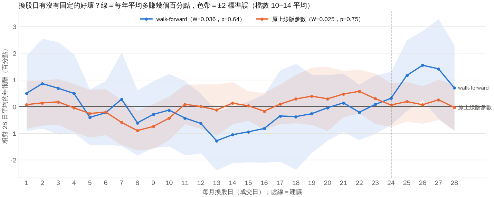
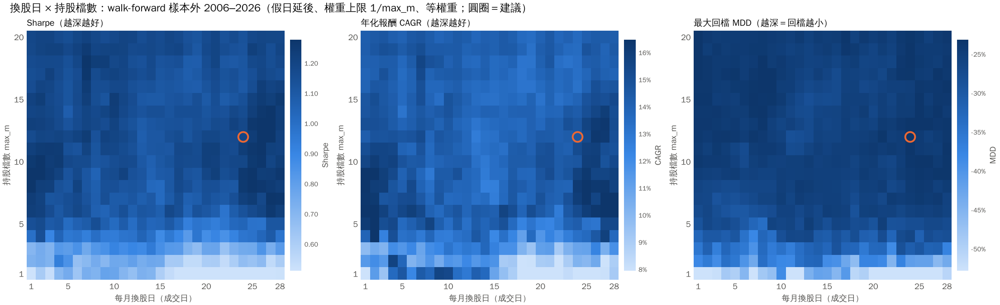
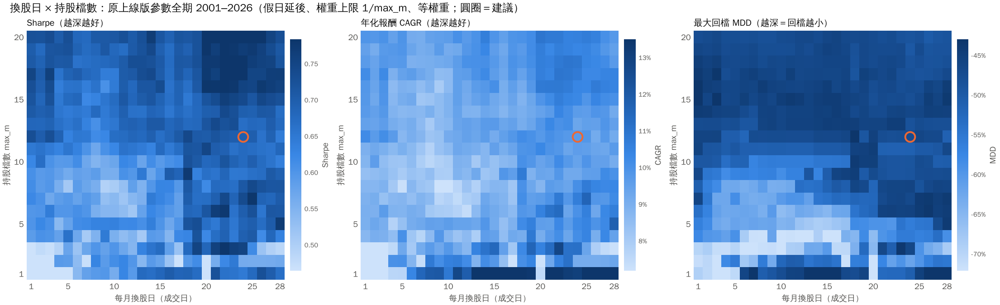
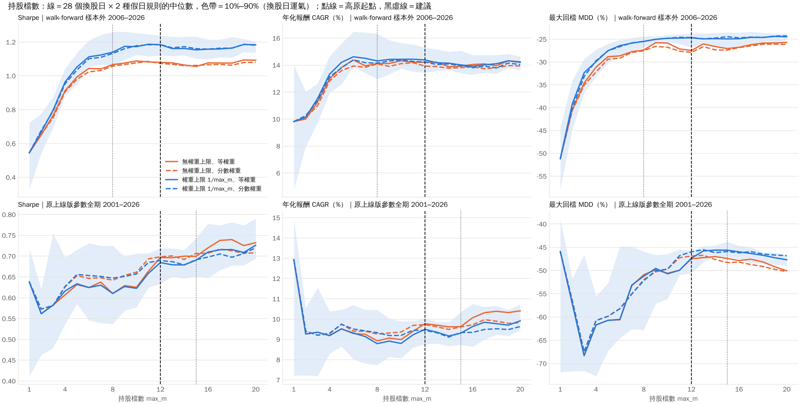

# 換股日 × 假日規則 × 持股檔數

> 本檔由 `python -m twstable sweep-report` 從 `grid.csv` 產生，請勿手改。
> 需求見 [`genesis/FIAT-hyper-parameters.md`](../../genesis/FIAT-hyper-parameters.md)。
> 本頁的「原上線版參數」是第一次 WFCV（`results/wfcv.json`）那組。採用本頁建議後，上線版已改為固定這些設定重跑的 WFCV（`results/wfcv_monthly.json`，見 README 第五節）。

## 結論

- **每月 24 日換股**（24 日下單成交，前一個交易日晚上選股）；其實 **22 日到隔月 3 日之間任選一天都差不多**，沒有哪一天穩定勝出（見「換股日」）。
- **遇到假日：延後到下一個交易日**。兩種規則差異很小，選這個只是因為樣本外略好一點。
- **持股 12 檔**；少於 8 檔開始變差，3 檔以下就真的不能用（見「持股檔數」）。
- **開啟權重上限 `cap_weight`**（每檔最多 1/12，選不滿就留現金）
- **等權重**：依分數加權沒有比較好，交易還略多。

| | CAGR | Sharpe | 最大回檔 | 最差一年 |
|---|---|---|---|---|
| walk-forward 樣本外：原設定 | +15.0% | 1.12 | -28.2% | -11.4% |
| walk-forward 樣本外：**建議設定** | +14.6% | 1.19 | -23.0% | -8.7% |
| 原上線版參數全期：原設定 | +10.2% | 0.72 | -44.1% | -22.7% |
| 原上線版參數全期：**建議設定** | +9.7% | 0.70 | -47.5% | -26.1% |

**原上線版參數下，建議設定略差於原設定**（Sharpe 0.70 對 0.72）。原上線版參數是在「每 40 個交易日換股、10 檔」的前提下挑的，換成每月換股本來就不在它的最佳點；而且差距在換股日運氣的範圍內（12 檔、28 個換股日的 Sharpe 10%–90% 是 0.63–0.72）。

原設定：walk-forward 各折用自己挑的換股間隔與檔數；原上線版是每 40 個交易日、10 檔。
建議設定套到原上線版參數上，見 [`recommended_params.json`](recommended_params.json)。

**兩種評估**：

- **walk-forward**：沿用 `results/wfcv.json` 每一折自己的參數，只換掉換股日、假日規則、檔數、權重上限與權重方式，再把 2006–2026 各折的樣本外曲線串起來。這是比較可信的估計。
- **原上線版參數**：用 `results/wfcv.json` 的 `production_params`（第一次 WFCV，以 2020–2026 訓練）跑 2001–2026。2001–2019 對它其實是「往回的樣本外」，所以當作交叉驗證：結論要在兩邊都站得住。

## 換股日

每一年把 28 個換股日依當年報酬排名，再看各年的排名有沒有一致（Kendall's W，0＝毫無關聯，1＝每年一模一樣）。虛無分布是把每一年的日序各自隨機平移，保留「相鄰幾天常在同一天成交」的相關。

| 評估 | 年數 | W | 隨機時的 W 中位數 | p 值 |
|---|---|---|---|---|
| walk-forward | 21 | 0.036 | 0.043 | 0.64 |
| 原上線版參數 | 26 | 0.025 | 0.035 | 0.75 |

**p 值都很大：某一天今年表現好，明年並不會比較好。** 熱力圖上看得到的深淺，大多是「那幾天剛好躲過或碰上某次大跌」的運氣。

兩種評估倒是有一個共同的弱傾向：**月中（約 5–17 日）略差、下旬略好**。這跟「每月 10 日前公布營收」的時間點吻合，但幅度只有每年約一個百分點、且不跨年一致，所以只拿來挑一個「兩邊都不吃虧」的日子，不要期待它會重演。
建議日是兩種評估在平滑後 Sharpe 上「較差的那一邊」最好的一天（maximin）。

## 假日提前或延後

兩種規則只在「選定日剛好不是交易日」的月份不同，所以逐格（同一天、同一檔數）相減：

| 評估 | 延後 − 提前：Sharpe | CAGR | 延後較好的格子 | 逐年差的 t 值 |
|---|---|---|---|---|
| walk-forward | +0.009 | +0.1% | 56% | +1.04 |
| 原上線版參數 | -0.002 | -0.0% | 50% | -0.37 |

差距在雜訊範圍內（|t| 遠小於 2）。**提前或延後都可以**，挑一個固定下來就好。

## 持股檔數

高原起點＝從這個檔數起，每個更大的檔數其 Sharpe 中位數都在最好那個的 95% 以內。

| 評估 | 高原起點 | 跌破最好的 80%（不能用）| 高原上的 Sharpe 中位數 |
|---|---|---|---|
| walk-forward | 8 檔 | 3 檔以下 | 1.16 |
| 原上線版參數 | 15 檔 | 2 檔以下 | 0.68 |

walk-forward 在 8 檔就到高原；原上線版參數要到 15 檔，因為它沒有避開 2008，持股越多、那次股災跌得越少。建議取兩個起點的中間：**12 檔**。

同一個檔數下 28 個換股日的差異（色帶）也是風險：檔數越少，「哪天換股」的運氣影響越大。以 walk-forward 為例（cap=on,equal）：

| 檔數 | Sharpe 10%／中位數／90% | CAGR 中位數 | 最大回檔 中位數 | 最差一年 中位數 | 原上線版 Sharpe 中位數 |
|---|---|---|---|---|---|
| 1 | 0.33／0.54／0.72 | +9.8% | -51.2% | -38.8% | 0.64 |
| 2 | 0.54／0.67／0.78 | +10.1% | -39.3% | -25.0% | 0.56 |
| 3 | 0.69／0.80／0.87 | +11.5% | -32.4% | -21.0% | 0.58 |
| 4 | 0.88／0.96／1.04 | +13.3% | -30.0% | -15.3% | 0.62 |
| 5 | 0.95／1.05／1.14 | +14.2% | -27.6% | -12.3% | 0.63 |
| 6 | 1.05／1.11／1.21 | +14.6% | -26.5% | -7.2% | 0.62 |
| 8 | 1.06／1.14／1.26 | +14.3% | -25.5% | -5.9% | 0.61 |
| 10 | 1.12／1.17／1.25 | +14.4% | -24.8% | -6.7% | 0.62 |
| 12 | 1.12／1.18／1.24 | +14.4% | -24.7% | -7.5% | 0.68 |
| 15 | 1.10／1.15／1.23 | +14.0% | -25.0% | -6.4% | 0.69 |
| 20 | 1.14／1.18／1.20 | +14.2% | -24.5% | -7.4% | 0.73 |

## 權重上限與權重方式

| 設定 | walk-forward 高原 Sharpe | 原上線版高原 Sharpe | walk-forward 高原起點 |
|---|---|---|---|
| 無權重上限、等權重 | 1.07 | 0.70 | 6 檔 |
| 無權重上限、分數權重 | 1.07 | 0.70 | 7 檔 |
| 權重上限 1/max_m、等權重 | 1.16 | 0.68 | 8 檔 |
| 權重上限 1/max_m、分數權重 | 1.16 | 0.69 | 8 檔 |

**權重上限**：候選股不足 12 檔時，沒開上限會把全部資金平分給剩下的幾檔（2008 年曾連續 4 次全押 1 檔）。開了之後空出來的部分留現金。以原換股間隔、12 檔的 walk-forward 為例：2008 年 -11.3% → +0.6%，最大回檔 -28.4% → -23.6%，Sharpe 1.12 → 1.24。原上線版參數在股災時候選股還很多，所以幾乎沒差。

**權重方式**：依分數加權必須比等權重高出 0.02 以上的 Sharpe 才採用，結果沒有；它的周轉率還略高。遲滯（`hold_mult`、`keep_frac`）與權重不交易帶（`weight_band`）已經讓分數下滑的股票不會被立刻賣掉，分數權重的「漸漸離開」沒有帶來額外好處。

## 每月固定日 vs 原本的固定交易日間隔

walk-forward 各折原本用自己挑的間隔（10–60 個交易日）。改成每月固定一天，各檔數的 Sharpe 中位數都落在原設定附近：

| 檔數 | 原間隔 | 每月固定日 中位數（10%–90%）|
|---|---|---|
| 5 | 0.95 | 1.05（0.95–1.14）|
| 8 | 1.18 | 1.14（1.06–1.26）|
| 10 | 1.14 | 1.17（1.12–1.25）|
| 12 | 1.24 | 1.18（1.12–1.24）|
| 15 | 1.14 | 1.15（1.10–1.23）|
| 20 | 1.23 | 1.18（1.14–1.20）|

**改成每月固定日換股不會吃虧**，而且實務上規律、好執行。

## 限制

- 換股日、檔數之外的參數是各折用**原本的**換股間隔與檔數挑出來的；這裡只覆寫這幾項，沒有重新搜尋。理想上應把新參數放進 WFCV 搜尋空間重跑。
- 28 × 2 × 20 × 2 × 2 個組合看了這麼多格，最好的那一格必然偏樂觀；所以只看區域與跨年一致性，不採用單格最佳值。
- README 提過的偏誤（倖存者偏誤、基準不含息、以收盤價成交）在這裡都還在。

## 檔案

- `grid.csv`：每個組合一列（`id` 與 `curves.parquet` 對應），含各項指標與每年報酬。
- `curves.parquet`：每個組合的月底權益曲線（長表：`id`、`date`、`equity`）。
- `summary.json`：本頁所有數字。
- 重跑整個參數空間：`python -m twstable sweep`（約 15 分鐘，4 核心）；只重做本頁與圖：`python -m twstable sweep-report`（幾秒）。
